# GreenOps Transcend Duo — Autonomous 9-Stage GitLab Duo Agent Platform + ISO/IEC 21031 SCI Carbon-Aware Google Cloud Orchestrator

[](.gitlab/duo/flows/greenops-transcend-flow.yml)
[](.gitlab-ci.yml)
[](backend/transcend_engine.py)
[](backend/transcend_engine.py)
[](LICENSE)

> **Official Submission for the [Life After Code: GitLab Transcend Hackathon](https://gitlab-transcend.devpost.com/)**  
> **Target Prize Categories**:
> - **Primary Path B / Path A ($5,000)**: Custom Agent & Official Flow Registry `v1` Orchestration across the GitLab SDLC
> - **Most Stages Covered ($5,000)**: Native automation across **all 9 official GitLab DevSecOps stages** (`plan`, `create`, `verify`, `package`, `secure`, `release`, `configure`, `monitor`, `govern`)
> - **Most Environmentally Impactful ($5,000)**: Real-time **ISO/IEC 21031:2024 Software Carbon Intensity (SCI)** reduction (`-96.17% CO2eq/req`) + Carbon-Aware **Google Cloud Region Routing (`+0.2 Bonus Points`)**

---

## Live Links & Demo

- **Interactive 9-Stage GreenOps Workbench**: [`https://kevin9327.github.io/GitLabTranscendDuo/`](https://kevin9327.github.io/GitLabTranscendDuo/)
- **Official GitLab Repository & 9-Stage Pipeline**: [`https://gitlab.com/kevin9327-group/greenops-transcend-duo`](https://gitlab.com/kevin9327-group/greenops-transcend-duo)
- **GitHub Mirror Repository**: [`https://github.com/kevin9327/GitLabTranscendDuo`](https://github.com/kevin9327/GitLabTranscendDuo)

---

## Why GreenOps Transcend Duo Stands Out

1. **100% Authentic GitLab Duo Flow Registry `v1` Schema ([`.gitlab/duo/flows/greenops-transcend-flow.yml`](.gitlab/duo/flows/greenops-transcend-flow.yml))**:
   - Uses GitLab's official `version: "v1"`, `environment: ambient`, `AgentComponent` definitions, `routers` DAG transitions, `flow.entry_point`, and inline `prompts` with official GitLab Duo toolsets (`get_issue`, `get_merge_request`, `list_merge_request_diffs`, `get_repository_file`, `create_commit`, `get_pipeline_errors`, `create_merge_request_note`, `create_issue_note`, `create_issue`).
   - Paired with [`.gitlab/duo/agent-config.yml`](.gitlab/duo/agent-config.yml) and [`AGENTS.md`](AGENTS.md).
2. **All 9 Official GitLab DevSecOps Stages Covered ([`.gitlab-ci.yml`](.gitlab-ci.yml))**:
   - Every commit and Merge Request executes 9 dedicated autonomous jobs across `plan` → `create` → `verify` → `package` → `secure` → `release` → `configure` → `monitor` → `govern`, producing structured JSON artifacts and Cobertura/JUnit telemetry.
3. **Mathematical ISO/IEC 21031:2024 Software Carbon Intensity (SCI) Engine ([`backend/transcend_engine.py`](backend/transcend_engine.py))**:
   $$\text{SCI} = \frac{(E \times I) + M}{R}$$
   - Computes operational emissions ($E \times I$) using real Google Cloud PUE and ElectricityMaps grid intensity alongside hardware embodied emissions ($M$, amortized across 4-year server lifespan and vCPU allocation) per functional unit ($R = 1,000\text{ API requests}$).
4. **Google Cloud Carbon-Free Energy (CFE%) Region Router (`+0.2 Bonus Points`)**:
   - Automatically shifts GitLab Runners and Cloud Run / GKE deployments from carbon-heavy grids (`us-east4` Northern Virginia at `410 gCO2eq/kWh`, `48% CFE`) to `europe-north1` (Finland at `42 gCO2eq/kWh`, `94% CFE`, `1.09 PUE`) or `northamerica-northeast1` (Montréal at `28 gCO2eq/kWh`, `96% CFE`), cutting per-request carbon intensity by **96.17%** (`193.02 g` → `7.38 g CO2eq / 1k requests`, saving **100,247 kg CO2e/year**).
5. **9-Tool JSON-RPC 2.0 MCP Server ([`backend/mcp_server.py`](backend/mcp_server.py))**:
   - Exposes all 9 stage agents as Model Context Protocol (MCP) tools (`duo_plan_sci_audit` through `duo_govern_policy_enforce`) for seamless invocation by GitLab Duo Agent Platform.

---

## 9-Stage Architecture

```mermaid
flowchart LR
    S1["1. PLAN\nduo_green_planner"] --> S2["2. CREATE\nduo_green_refactorer"]
    S2 --> S3["3. VERIFY\nduo_verify_architect"]
    S3 --> S4["4. PACKAGE\nduo_container_slimmer"]
    S4 --> S5["5. SECURE\nduo_secops_guardian"]
    S5 --> S6["6. RELEASE\nduo_release_orchestrator"]
    S6 --> S7["7. CONFIGURE\nduo_cloud_region_router"]
    S7 --> S8["8. MONITOR\nduo_telemetry_sentinel"]
    S8 --> S9["9. GOVERN\nduo_governance_auditor"]
```



---

## Quick Start

```bash
pip install -r requirements.txt

# 1. Execute all 9 GitLab DevSecOps stages and generate artifacts/
python scripts/run_9stage_pipeline.py --stage all --scenario llm_rag_microservice --output-dir artifacts

# 2. Run the test suite
python -m pytest tests/test_transcend_duo.py -v

# 3. Launch the interactive 9-Stage GreenOps Workbench (http://127.0.0.1:8095)
python -m backend.server
```
